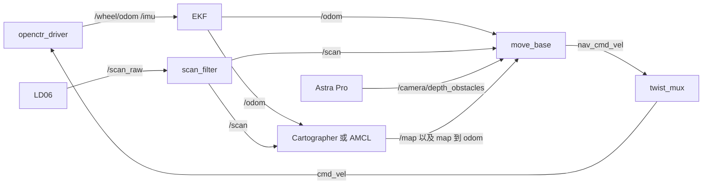

# Flyingshark R10

香橙派 5 Max（RK3588，aarch64）上的两轮差速小车。底盘是塔克 XTARK R10，控制板 OPENCTR B20，激光雷达 LD06，深度相机 Astra Pro。系统是 Ubuntu 20.04、ROS Noetic。工作空间固定在 `/home/orangepi/Flyingshark_agv`。

坐标原点是 `base_footprint`，在两轮接地点的中心，贴地。x 朝前，y 朝左，z 朝上，单位米。下面的安装位置都相对这个原点。

顶层五个目录各自是一个 catkin 工作空间，按依赖顺序由 `shfiles/env.sh` 叠加。不要在仓库根目录执行 `catkin_make`。

## 目录架构

```
Flyingshark_agv/
├── driver/          工作空间：底盘、雷达、相机
├── slam/            工作空间：Cartographer（隔离编译）
├── navigation/      工作空间：move_base 参数
├── utils/           工作空间：车体模型、EKF、总启动
├── ui/              工作空间：网页控制台
├── shfiles/         环境、启动脚本、udev、systemd 单元
├── map/             栅格地图、pbstream、网页速度设置
└── data/            备用路点，当前为空
```

`build/`、`devel/`、`install/`、`build_isolated/`、`devel_isolated/`、`install_isolated/` 是编译产物，已写进 `.gitignore`。`slam` 用 `catkin_make_isolated --install`，所以产物目录名和另外四个工作空间不同。

### driver

| 包名 | 源码目录 | 作用 |
| --- | --- | --- |
| `openctr_driver` | `driver/src/openctr_driver/` | 自写。串口读写 B20，发布轮式里程计和 IMU，订阅 `cmd_vel` |
| `ldlidar_stl_ros` | `driver/src/ldlidar_stl_ros/` | 乐动雷达驱动。本车只用 `launch/ld06.launch` |
| `astra_camera` | `driver/src/ros_astra_camera/` | 奥比中光驱动。本车只用 `launch/astra_pro.launch` 和 `scripts/astra_audio.py` |

`openctr_driver` 里实际要改的文件：

| 文件 | 内容 |
| --- | --- |
| `src/openctr_driver.cpp` | 帧解析、串口自动选择、速度下发、陀螺仪零偏 |
| `config/openctr.yaml` | 波特率、轮径比例、PID、零偏时间 |
| `launch/openctr.launch` | 节点启动，端口可被上层覆盖 |

### slam

| 包名 | 源码目录 | 作用 |
| --- | --- | --- |
| `cartographer` | `slam/src/cartographer/` | 上游 SLAM 库，源码编译 |
| `cartographer_ros` | `slam/src/cartographer_ros/` | 上游 ROS 封装，含 `cartographer_ros`、`cartographer_ros_msgs`、`cartographer_rviz` |
| `flyingshark_slam` | `slam/src/flyingshark_slam/` | 本车的 lua 和 launch |

本车只改 `flyingshark_slam`：

| 文件 | 内容 |
| --- | --- |
| `config/flyingshark_2d.lua` | 默认建图：激光 + `/odom` + IMU，回环打开 |
| `config/flyingshark_2d_lidar_only.lua` | 底盘没接上时只用激光推里程计 |
| `config/flyingshark_localization.lua` | 在已有 pbstream 上做纯定位。当前导航走 AMCL，这个文件留着备用 |
| `launch/cartographer.launch` | 起 `cartographer_node` 和栅格发布节点 |

### navigation

包名 `flyingshark_navigation`。没有自写节点，全是 move_base 的参数和 launch。

| 文件 | 内容 |
| --- | --- |
| `launch/move_base.launch` | 加载下面全部 yaml，局部规划默认 TEB，`cmd_vel` 重映射到 `nav_cmd_vel` |
| `config/move_base.yaml` | 控制频率、恢复行为 |
| `config/global_planner.yaml` | 全局规划用栅格回溯 |
| `config/global_costmap.yaml` | 全局代价地图，坐标系 `map`，含静态层 |
| `config/local_costmap.yaml` | 局部代价地图，4 m × 4 m 滚动窗口，坐标系 `odom` |
| `config/costmap_common.yaml` | 激光障碍层、深度障碍层、膨胀层，外壳半径 0.108 m |
| `config/amcl.yaml` | 已知地图上的粒子滤波 |
| `config/teb.yaml` | 默认局部规划 |
| `config/dwa.yaml` | 备用局部规划，启动时加 `local_planner:=dwa` |

### utils

| 包名 | 文件 | 内容 |
| --- | --- | --- |
| `flyingshark_description` | `urdf/r10.urdf.xacro` | 车体、轮子、IMU、雷达、相机的连杆和安装位姿 |
| | `launch/description.launch` | 把 xacro 写成 `robot_description`，起 `robot_state_publisher` |
| `flyingshark_bringup` | `launch/bringup.launch` | 模型、底盘、雷达、角度裁剪、相机、EKF、twist_mux |
| | `launch/camera.launch` | Astra Pro 彩色、深度、对齐点云、麦克风，再降采样 |
| | `launch/mapping.launch` | 驱动（可关）+ Cartographer 建图 |
| | `launch/blank_nav.launch` | 驱动 + Cartographer 边建图 + move_base |
| | `launch/navigation.launch` | 驱动 + `map_server` + AMCL + move_base |
| | `launch/height_map_overlay.launch` | 可选。把高于雷达的深度点画进栅格。默认流程不包含它 |
| | `config/ekf.yaml` | 线速度用轮式里程计，航向角速度用陀螺仪 Z |
| | `config/twist_mux.yaml` | 手动速度优先于导航速度 |
| | `config/astra_rgb.yaml` | 彩色相机内参占位（640×480，未做标定） |
| | `scripts/scan_filter.py` | `/scan_raw` → `/scan`，裁掉车身后方被铝柱挡住的角度 |
| | `scripts/depth_cloud_downsample.py` | 深度点云抽稀，只留离地 0.12–0.65 m 的表面，发布 `/camera/depth_obstacles` |
| | `scripts/rgb_cloud_downsample.py` | 彩色点云抽稀，给网页和 RViz，发布 `/camera/rgb_points` |
| | `scripts/height_map_overlay.py` | 配合上面那个可选 launch |
| | `rviz/flyingshark.rviz` | 终端开导航时的 RViz 配置 |

### ui

包名 `flyingshark_webui`。

| 文件 | 内容 |
| --- | --- |
| `scripts/webui_node.py` | ROS 节点兼 HTTP 服务，默认 `0.0.0.0:8080` |
| `launch/webui.launch` | 带 `port` 参数的启动文件。开机服务直接跑脚本 |
| `web/index.html` | 页面结构 |
| `web/app.js` | 按钮、摇杆、地图交互、和后端的 SSE |
| `web/view3d.js` | 地图、激光、点云、路径的绘制 |
| `web/style.css` | 样式 |

网页通过 `POST /api/cmd` 发操作，通过 `GET /events` 收位姿和地图，通过 `GET /camera` 收 MJPEG。静态文件从 `web/` 读出。

### shfiles

| 文件 | 内容 |
| --- | --- |
| `env.sh` | 按顺序 source 五个工作空间，设置 `ROS_MASTER_URI`，尝试把 usbfs 调到 128 MB |
| `ensure_drivers.sh` | 被其他脚本 source。没有 roscore 就拉起，没有 EKF 就拉起 `bringup.launch` |
| `init.sh` / `bringup.sh` | 只开底盘、雷达、相机、EKF |
| `mapping.sh` | 建图。已有驱动则 `start_drivers:=false` |
| `blank_nav.sh` | 无地图导航 |
| `navigation.sh` | 读 `map/r10.yaml` 做 AMCL 导航 |
| `save_map.sh` | 把当前 `/map` 存成 `map/r10.yaml`，并写 `map/r10.pbstream` |
| `webui.sh` | 手动开网页 |
| `camera.sh` | 只开相机 |
| `teleop.sh` | 键盘遥控，发到 `teleop_cmd_vel` |
| `probe_base.sh` | 扫串口，看有没有塔克帧头 `0xAA 0x55` |
| `99-flyingshark-serial.rules` | `/dev/openctr`、`/dev/ldlidar` |
| `flyingshark-webui.service` | 网页开机自启 |
| `flyingshark-usbfs.service` | 开机把 USB 缓冲调到 128 MB |

### map 和 data

| 文件 | 内容 |
| --- | --- |
| `map/r10.yaml` + `map/r10.pgm` | 默认栅格地图。yaml 里的 `image` 是绝对路径 |
| `map/r10.pbstream` | Cartographer 状态。保存脚本会写它；当前已知地图导航用的是上面的栅格，配合 AMCL |
| `map/blank.yaml` + `map/blank.pgm` | 全空占位图。空白导航不读它，地图由 Cartographer 从零发布 |
| `map/webui_settings.json` | 网页里的手动速度、导航速度、键盘开关 |
| `data/waypoints.yaml` | 备用路点格式，列表是空的。网页目标点直接点在地图上，不读这个文件 |

路径写死在这些位置，换目录时要一起改：`shfiles/env.sh`、`ui/src/flyingshark_webui/scripts/webui_node.py` 里的 `ROOT`、`navigation.launch` 的默认地图、`cartographer.launch` 的 pbstream 路径、`camera.launch` 的彩色内参路径、两个 systemd 单元、`map/r10.yaml` 的 `image` 字段。

## 运行时数据流

三种功能互斥。建图和空白导航由 Cartographer 发布 `map` → `odom`。已知地图导航改由 AMCL 发布这一段，同时不再开 Cartographer。EKF 一直发布 `odom` → `base_footprint`。



网页摇杆和 `teleop.sh` 发 `teleop_cmd_vel`，优先级 100。导航发 `nav_cmd_vel`，优先级 10。两边超时都是 0.5 秒，松手后底盘收不到新速度就会停。底盘节点自己也有 0.5 秒 `cmd_timeout`。

| 话题 | 类型 | 谁发布 |
| --- | --- | --- |
| `/wheel/odom` | `nav_msgs/Odometry` | 底盘，编码器 |
| `/imu` | `sensor_msgs/Imu` | 底盘上的 IMU |
| `/odom` | `nav_msgs/Odometry` | EKF |
| `/voltage` | `std_msgs/Float32` | 底盘电压 |
| `/scan_raw` | `sensor_msgs/LaserScan` | LD06 |
| `/scan` | `sensor_msgs/LaserScan` | `scan_filter` |
| `/camera/color/image_raw` | `sensor_msgs/Image` | Astra 彩色 |
| `/camera/depth/points` | `sensor_msgs/PointCloud2` | Astra 深度 |
| `/camera/depth_registered/points` | `sensor_msgs/PointCloud2` | 对齐到彩色的点云 |
| `/camera/depth_obstacles` | `sensor_msgs/PointCloud2` | 抽稀后的避障点 |
| `/camera/rgb_points` | `sensor_msgs/PointCloud2` | 抽稀后的彩色点云 |
| `/camera/audio/left`、`/camera/audio/right` | `std_msgs/Int16MultiArray` | 相机麦克风 |
| `/map` | `nav_msgs/OccupancyGrid` | 建图时是 Cartographer，已知地图时是 `map_server` |
| `/cmd_vel` | `geometry_msgs/Twist` | `twist_mux` 仲裁后的最终速度 |
| `/move_base_simple/goal` | `geometry_msgs/PoseStamped` | 网页目标点 |
| `/initialpose` | `geometry_msgs/PoseWithCovarianceStamped` | 网页手动重定位 |

TF 从 `r10.urdf.xacro` 来，由 `robot_state_publisher` 发布固定关节：

```
base_footprint
├── base_link          z = 轮半径 0.037 m
│   ├── base_imu_link  再高 0.02 m
│   ├── left_wheel     y = +0.082 m
│   └── right_wheel    y = -0.082 m
├── laser              x = 0.060, z = 0.105
└── camera_link        x = 0.055, z = 0.160
```

Astra 驱动在 `camera_link` 下再发光学坐标系。Cartographer 的跟踪坐标系是 `base_imu_link`，发布坐标系是 `odom`，自己不提供 odom 坐标系（`provide_odom_frame = false`）。

## 外形

外壳按圆处理，半径 0.108 m。车顶离地约 0.20 m。模型里的圆柱只表示底盘一圈，高 40 mm，整车高度不在模型里。

| 项目 | 数值 |
| --- | --- |
| 外壳半径 | 0.108 m |
| 车顶离地 | 约 0.20 m |
| 轮胎直径 | 74 mm |
| 轮胎宽度 | 30 mm |
| 两轮中心距 | 164 mm |
| 轮心离地 | 37 mm |

改安装位置时，同时改 `utils/src/flyingshark_description/urdf/r10.urdf.xacro` 和 `utils/src/flyingshark_bringup/launch/bringup.launch` 里传给模型的 `lidar_*`、`camera_*`。外壳半径还要和 `navigation` 里的 `robot_radius`、`costmap_common.yaml` 的 `robot_radius`、`teb.yaml` 的 `footprint_model/radius` 一致。`bringup.launch` 的 `chassis_radius` 和导航的 `robot_radius` 默认都是 0.108。

## 传感器与接线

### 串口

两路都是板载 40 pin UART，3.3 V，波特率 230400。设备树 overlay 写在 `/boot/orangepiEnv.txt`：

```
overlay_prefix=rk3588
overlays=... uart2-m0 ... uart6-m1 ...
```

本机完整一行是 `uart0-m2 uart1-m1 uart2-m0 uart3-m1 uart4-m2 uart6-m1 uart7-m2 uart8-m1`。缺 `uart2-m0` 或 `uart6-m1` 时加上，然后重启。对应关系：

| 设备 | overlay | 设备节点 | udev 符号链接 | 40 pin |
| --- | --- | --- | --- | --- |
| OPENCTR B20 | `uart2-m0` | `/dev/ttyS2` | `/dev/openctr` | 8 脚 TX 接控制板 RX，10 脚 RX 接控制板 TX，共地 |
| LD06 | `uart6-m1` | `/dev/ttyS6` | `/dev/ldlidar` | 13 脚 TX 接雷达 RX，11 脚 RX 接雷达 TX，共地 |

底盘参数 `port: auto` 时，驱动优先打开 `/dev/openctr`，并跳过已经链到雷达的那个串口。

### LD06

装在车心前方，扫描面离地 105 mm，朝向与车头一致。后方约 120° 到 240° 被铝柱挡住，`scan_filter.py` 把这段裁成无效。有效距离 0.08 m 到 8 m。坐标系 `laser`。

### Astra Pro

一根 USB 线，里面有集线器。彩色相机是 `2bc5:0501`，深度芯片是 `2bc5:0403`。必须插 USB 3 口，两路才会都出来。插板载 USB 2 口时，经常只有彩色、没有深度。网页在开建图或导航时如果看不到深度芯片，会在状态栏加上这句提示。

相机在车头前方 55 mm、离地 160 mm，朝前，没有俯仰。图像 640×480，15 Hz。避障只用离地 0.12 m 到 0.65 m、相机真正看到的表面。代价地图只标记这些点，不沿射线清除背后的空地，床和桌子可以绕过去。深度点不写进 Cartographer 的全局地图。

外形在模型里是 90 × 30 × 25 mm 的盒子。坐标系 `camera_link`。

麦克风在深度芯片上，双声道，16000 Hz，S16_LE，声卡 `hw:Pro,0`。它是立体声，左右声道对应网页上的两根响度条，不能判断声源方向。

### IMU

在 OPENCTR B20 上，坐标系 `base_imu_link`。相对 `base_link` 高 20 mm，离地 57 mm，没有额外旋转。Cartographer 的跟踪坐标系就是它。起步时让车停稳约 2 秒，驱动用这段时间估陀螺仪零偏（`gyro_bias_seconds: 2.0`）。

## 从零配置

下面按一台新的香橙派 5 Max、Ubuntu 20.04 来写。用户名按 `orangepi`，仓库放在 `/home/orangepi/Flyingshark_agv`。已经配好的机器只需对照第 7 节编译、第 8 节服务。

### 1. 系统与用户组

确认系统：

```bash
lsb_release -sc          # focal
uname -m                 # aarch64
```

串口要 `dialout`，相机要 `video`，麦克风要 `audio`：

```bash
sudo usermod -aG dialout,video,audio,plugdev "$USER"
```

重新登录后再做后面的步骤。用 `id` 看组是否生效。

### 2. 安装 ROS Noetic

```bash
sudo apt update
sudo apt install -y curl gnupg lsb-release
sudo curl -sSL https://raw.githubusercontent.com/ros/rosdistro/master/ros.key \
  -o /usr/share/keyrings/ros-archive-keyring.gpg
echo "deb [arch=$(dpkg --print-architecture) signed-by=/usr/share/keyrings/ros-archive-keyring.gpg] http://packages.ros.org/ros/ubuntu $(lsb_release -sc) main" \
  | sudo tee /etc/apt/sources.list.d/ros-latest.list
sudo apt update
sudo apt install -y ros-noetic-desktop python3-rosdep python3-catkin-tools
```

交互式终端方便手敲 `rostopic`，把 ROS 写进 `~/.bashrc`。启动脚本自己会 source，不依赖这一行。

```bash
grep -q 'source /opt/ros/noetic/setup.bash' ~/.bashrc || \
  echo 'source /opt/ros/noetic/setup.bash' >> ~/.bashrc
source /opt/ros/noetic/setup.bash
```

### 3. 安装本车依赖

ROS 功能包：

```bash
sudo apt install -y \
  ros-noetic-navigation \
  ros-noetic-robot-localization \
  ros-noetic-teb-local-planner \
  ros-noetic-twist-mux \
  ros-noetic-teleop-twist-keyboard \
  ros-noetic-serial \
  ros-noetic-joint-state-publisher \
  ros-noetic-robot-state-publisher \
  ros-noetic-xacro \
  ros-noetic-cv-bridge \
  ros-noetic-image-transport \
  ros-noetic-camera-info-manager \
  ros-noetic-rgbd-launch \
  ros-noetic-diagnostic-updater
```

相机、雷达编译和网页用的系统库：

```bash
sudo apt install -y \
  build-essential cmake git pkg-config \
  libusb-1.0-dev libudev-dev libuvc-dev libdw-dev \
  libopencv-dev python3-opencv python3-serial \
  v4l-utils alsa-utils
```

Cartographer 在 Ubuntu 20.04 上的依赖，与仓库里 `slam/src/cartographer/scripts/install_debs_cmake.sh` 一致：

```bash
sudo apt install -y \
  clang g++ ninja-build stow \
  libboost-all-dev libcairo2-dev libceres-dev \
  libcurl4-openssl-dev libeigen3-dev \
  libgflags-dev libgoogle-glog-dev liblua5.2-dev \
  libsuitesparse-dev libgmock-dev protobuf-compiler \
  python3-sphinx
```

Focal 的 apt 没有 Cartographer 需要的那版 Abseil，用仓库脚本装到 `/usr/local`（经 `stow`）。需要联网，编译要几分钟：

```bash
bash /home/orangepi/Flyingshark_agv/slam/src/cartographer/scripts/install_abseil.sh
```

脚本会把 abseil 固定在提交 `215105818dfde3174fe799600bb0f3cae233d0bf`（20211102.0）。

### 4. 串口和相机权限

```bash
sudo cp /home/orangepi/Flyingshark_agv/shfiles/99-flyingshark-serial.rules /etc/udev/rules.d/
sudo cp /home/orangepi/Flyingshark_agv/driver/src/ros_astra_camera/56-orbbec-usb.rules /etc/udev/rules.d/
sudo udevadm control --reload-rules
sudo udevadm trigger
```

插好线之后应能看到：

```bash
ls -l /dev/openctr /dev/ldlidar
# openctr -> ttyS2 ，ldlidar -> ttyS6 ，权限 crw-rw-rw-
lsusb | grep 2bc5
# 0501 彩色，0403 深度。只有 0501 时换 USB 3 口
arecord -l | grep -i astra
```

串口没有塔克帧头时：

```bash
bash /home/orangepi/Flyingshark_agv/shfiles/probe_base.sh
```

`/dev/ttyS2` 或 `/dev/ttyS6` 不存在时，回到上一节检查 `/boot/orangepiEnv.txt` 的 overlay，改完重启。

### 5. USB 缓冲

Astra 在 USB 2 集线器后面时，默认 16 MB 的 usbfs 缓冲不够，深度流会起不来。开机服务把它设成 128 MB：

```bash
sudo cp /home/orangepi/Flyingshark_agv/shfiles/flyingshark-usbfs.service /etc/systemd/system/
sudo systemctl daemon-reload
sudo systemctl enable --now flyingshark-usbfs.service
cat /sys/module/usbcore/parameters/usbfs_memory_mb   # 应为 128
```

`shfiles/env.sh` 在当前用户对这个 sysfs 可写时也会写一次。服务负责开机时的那一次。

### 6. 编译五个工作空间

先 source ROS，再按目录编译。`slam` 最久，内存紧张时给它加 `-j2`。另外四个用普通 `catkin_make`。

```bash
source /opt/ros/noetic/setup.bash

cd /home/orangepi/Flyingshark_agv/driver
catkin_make

cd /home/orangepi/Flyingshark_agv/slam
catkin_make_isolated --install --use-ninja

cd /home/orangepi/Flyingshark_agv/navigation
catkin_make

cd /home/orangepi/Flyingshark_agv/utils
catkin_make

cd /home/orangepi/Flyingshark_agv/ui
catkin_make
```

检查叠加是否完整：

```bash
source /home/orangepi/Flyingshark_agv/shfiles/env.sh
rospack find openctr_driver
rospack find astra_camera
rospack find ldlidar_stl_ros
rospack find cartographer_ros
rospack find flyingshark_slam
rospack find flyingshark_navigation
rospack find flyingshark_bringup
rospack find flyingshark_description
rospack find flyingshark_webui
```

任何一个 `rospack find` 失败，就回到对应目录重新编译。`slam` 优先认 `install_isolated/setup.bash`，没有才退回 `devel_isolated`。

改了 Python 脚本或 launch 之后，对应工作空间再 `catkin_make` 一次。只改 yaml、lua、xacro 时，重新 launch 即可，xacro 在 `description.launch` 里每次启动现算。

### 7. 网页开机自启

```bash
sudo cp /home/orangepi/Flyingshark_agv/shfiles/flyingshark-webui.service /etc/systemd/system/
sudo systemctl daemon-reload
sudo systemctl enable --now flyingshark-webui.service
systemctl status flyingshark-webui.service
```

服务以用户 `orangepi` 运行 `shfiles/webui.sh`，失败 3 秒后重启，并且排在 `flyingshark-usbfs.service` 后面。网页监听 `0.0.0.0:8080`。浏览器打开香橙派的局域网地址，例如 `http://192.168.1.10:8080/`。同一台机器上是 `http://127.0.0.1:8080/`。

ROS 主节点留在本机。`env.sh` 把 `ROS_MASTER_URI` 设为 `http://127.0.0.1:11311`，`ROS_HOSTNAME` 设为 `127.0.0.1`。远程只用浏览器，不要把 ROS master 指到别的电脑。

### 8. 网页里的重启和关机

页面上的重启、关机调用：

```text
sudo -n /bin/systemctl reboot
sudo -n /bin/systemctl poweroff
```

需要免密，否则按钮会返回 sudo 的报错。新机器写一条规则：

```bash
echo 'orangepi ALL=(root) NOPASSWD: /bin/systemctl reboot, /bin/systemctl poweroff' \
  | sudo tee /etc/sudoers.d/flyingshark-power
sudo chmod 440 /etc/sudoers.d/flyingshark-power
sudo visudo -cf /etc/sudoers.d/flyingshark-power
```

本机这条规则已经在 `/etc/sudoers.d/flyingshark-power`。

### 9. 上电自检

传感器接好、车停稳，另开终端：

```bash
bash shfiles/init.sh
source shfiles/env.sh
rostopic hz /scan
rostopic hz /wheel/odom
rostopic hz /imu
rostopic hz /camera/color/image_raw
rostopic hz /camera/depth/points
```

底盘、雷达或相机没起来时看 `/tmp/flyingshark_bringup.log`。正常时网页上能看到画面、摇杆、激光和左右响度。起步两秒内不要推车，等陀螺仪零偏采完。

## 使用

网页开机就在。先点「初始化」。底盘、雷达、相机和麦克风会打开。建图或导航再点对应按钮。关掉建图或导航时，传感器继续开着。再点一次「初始化」会把传感器也关掉。

| 按钮 | 实际启动 | 说明 |
| --- | --- | --- |
| 初始化 | `bringup.launch` | 再点一次关闭传感器 |
| 手动建图 | `mapping.launch` | Cartographer，地图随走随长 |
| 保存地图 | `map_saver` + `/write_state` | 写到 `map/r10.yaml` 和 `map/r10.pbstream`，建图进程继续 |
| 无地图导航 | `blank_nav.launch` | 一边建图一边导航，适合没图的新场地 |
| 已知地图导航 | `navigation.launch` | 读下拉框里的 yaml，默认 `r10.yaml`，定位用 AMCL |
| 重定位 | `/global_localization` 后原地慢转约 14 秒 | 只在已知地图导航时有用。再点一次停止转动。这个模式下点地图，则按点击位置发 `/initialpose` |
| 导航点 | `/move_base_simple/goal` | 在地图上点选 |

设置里的手动线速度、角速度和导航线速度、角速度写进 `map/webui_settings.json`。导航速度通过 dynamic_reconfigure 改 TEB 或 DWA 的 `max_vel_x`、`max_vel_theta`。手动速度上限在代码里夹到线速度 0.05–0.6 m/s、角速度 0.2–1.5 rad/s。

终端里等价的命令：

```bash
bash shfiles/init.sh            # 底盘、雷达、相机、EKF
bash shfiles/mapping.sh         # 建图，默认不开 RViz
bash shfiles/save_map.sh        # 另一个终端，存到 map/r10.*
bash shfiles/blank_nav.sh       # 无地图导航，默认开 RViz
bash shfiles/navigation.sh      # 已存地图，AMCL，默认开 RViz
bash shfiles/webui.sh           # 手动开网页
bash shfiles/teleop.sh          # 键盘遥控
bash shfiles/camera.sh          # 只开相机
```

没有显示器时给导航加上 `open_rviz:=false`：

```bash
bash shfiles/navigation.sh open_rviz:=false
bash shfiles/blank_nav.sh open_rviz:=false
```

换局部规划器：

```bash
bash shfiles/navigation.sh local_planner:=dwa open_rviz:=false
```

`mapping.sh`、`blank_nav.sh`、`navigation.sh` 先调用 `ensure_drivers`，驱动已经在跑就不会再起一套。

已知地图导航要求 `map/r10.yaml` 已经存在，否则 `navigation.sh` 直接退出。网页的下拉框列出 `map/*.yaml`，跳过 `blank.yaml`。

建图时车速放慢，走闭合路线让回环生效。保存可以在建图过程中做，不必先停节点。`save_map.sh` 还会调用 `/finish_trajectory 0`，这条轨迹在 Cartographer 里就结束了；网页上的「保存地图」只写文件，不结束轨迹，建图可以继续。

日志：

| 文件 | 内容 |
| --- | --- |
| `/tmp/flyingshark_roscore.log` | 脚本拉起的 roscore |
| `/tmp/flyingshark_bringup.log` | `init.sh` / `ensure_drivers` 的 bringup |
| `/tmp/flyingshark_webui_init.log` | 网页点的初始化 |
| `/tmp/flyingshark_webui_mapping.log` | 网页建图 |
| `/tmp/flyingshark_webui_blank.log` | 网页无地图导航 |
| `/tmp/flyingshark_webui_nav.log` | 网页已知地图导航 |
| `journalctl -u flyingshark-webui -f` | 开机网页服务 |

## 参数改哪里

| 要改的东西 | 文件 |
| --- | --- |
| 雷达、相机安装位置 | `r10.urdf.xacro`，以及 `bringup.launch` 里的 `lidar_x`、`lidar_z`、`camera_x`、`camera_z` |
| 外壳半径 | xacro 的 `chassis_radius`，`bringup.launch`，`costmap_common.yaml` 的 `robot_radius`，`teb.yaml` 的 `radius`，导航 launch 的 `robot_radius` |
| 轮距、轮半径 | xacro 的 `wheel_separation`、`wheel_radius`；底盘上报若整体偏大或偏小，改 `openctr.yaml` 的 `linear_scale`、`angular_scale` |
| 底盘 PID、零偏时间 | `driver/src/openctr_driver/config/openctr.yaml` |
| 雷达裁剪角度 | `bringup.launch` 里 `scan_filter` 的 `angle_crop_min_deg`、`angle_crop_max_deg` |
| 雷达串口 | `bringup.launch` 的 `lidar_port`，默认 `/dev/ldlidar` |
| 避障高度 | `camera.launch` 里 `depth_cloud_downsample` 的 `min_z`、`max_z`，以及 `costmap_common.yaml` 的 `min_obstacle_height`、`max_obstacle_height` |
| 膨胀、障碍距离 | `costmap_common.yaml`，TEB 的 `min_obstacle_dist`、`inflation_dist` |
| 导航最高速度的默认值 | `teb.yaml` 的 `max_vel_x`、`max_vel_theta`。网页设置会在运行中覆盖 |
| 建图回环、量程 | `flyingshark_slam/config/flyingshark_2d.lua` |
| 初始定位 | `amcl.yaml` 的 `initial_pose_*`。偏了就在网页上重定位，或在 RViz 里用 2D Pose Estimate |
| 网页端口 | `webui.launch` 的 `port`，或 `rosrun flyingshark_webui webui_node.py _port:=8080` |
| 默认地图名 | `navigation.sh` 和 `navigation.launch` 里的 `map/r10.yaml`；保存脚本也写这个名字 |

## 排查

| 现象 | 处理 |
| --- | --- |
| `/dev/openctr` 或 `/dev/ldlidar` 不存在 | 查 udev 规则和 `/boot/orangepiEnv.txt` 的 `uart2-m0`、`uart6-m1`，改 overlay 后重启 |
| 底盘串口能开但没有里程计 | `bash shfiles/probe_base.sh`。帧头应出现在 230400。TX/RX 交叉、共地 |
| 只有彩色、没有深度 | 换板上的 USB 3 口。`lsusb` 里要同时有 `2bc5:0501` 和 `2bc5:0403`。确认 usbfs 是 128 |
| 网页打不开 | `systemctl status flyingshark-webui`。端口占用时改 `_port` |
| 建图车头越走越偏 | 起步两秒保持静止。EKF 的航向只采陀螺仪 Z，轮式角速度不进航向 |
| 已知地图导航车标乱跳 | 先点重定位，或把车放到建图起点再开导航。AMCL 默认初始位姿是地图原点、朝向 0 |
| 导航贴着障碍走或完全绕不开 | 核对三处外壳半径是不是都是 0.108。膨胀在 `costmap_common.yaml` 的 `inflation_radius` |
| 保存失败 | 建图节点要在，`/map` 要有数据。看命令输出和 `/tmp/flyingshark_webui_mapping.log` |
| `rospack find cartographer_ros` 失败 | `slam` 要用 `catkin_make_isolated --install`，并且 `source shfiles/env.sh` |
